# Informe de evaluacion 2: La raiz que se esconde

## 1. Introduccion

En esta evaluacion se implementaron seis metodos numericos para buscar raices de distintas funciones: biseccion, falsa posicion, punto fijo, secante, Newton-Raphson y Newton-Raphson mejorado.

Se utilizaron funciones polinomicas, logaritmicas, exponenciales, trigonometricas y mixtas, incluyendo una funcion con raiz doble.

El objetivo fue comparar la cantidad de iteraciones, los errores y el comportamiento de cada metodo.

Todas las pruebas utilizaron una tolerancia de 0.000001 y un maximo de 100 iteraciones.

## 2. Funciones utilizadas

| Funcion | Expresion | Intervalo o valor inicial | Raiz aproximada |
|---|---|---|---|
| Polinomica simple | x³ - x - 2 | [1, 2] | 1.521380 |
| Polinomica doble | (x - 2)² | x0 = 1.2 | 2.000000 |
| Logaritmica | ln(x) + x - 4 | [2, 3] | 2.926271 |
| Exponencial | e^(-x) - x | [0, 1] | 0.567143 |
| Trigonometrica | cos(x) - x | [0, 1] | 0.739085 |
| Mixta | √x - cos(x) | [0.1, 1] | 0.641714 |

En las funciones con raiz simple se verifico el cambio de signo en el intervalo. En la funcion polinomica doble se comprobo que la curva toca el eje horizontal en x = 2 sin atravesarlo.

## 3. Resultados de convergencia

La siguiente tabla muestra las iteraciones realizadas por cada metodo.

| Funcion | Biseccion | Falsa posicion | Punto fijo | Secante | Newton-Raphson | Newton mejorado |
|---|---:|---:|---:|---:|---:|---:|
| Polinomica simple | 20 | 12 | 7 | 4 | 2 | 2 |
| Polinomica doble | No aplica | No aplica | 100 (NC) | 15 | 10 | 1 |
| Logaritmica | 19 | 4 | 14 | 3 | 3 | 3 |
| Exponencial | 20 | 7 | 22 | 3 | 2 | 2 |
| Trigonometrica | 20 | 5 | 34 | 4 | 3 | 3 |
| Mixta | 20 | 4 | 100 (NC) | 3 | 2 | 2 |

NC significa que el metodo no alcanzo la tolerancia establecida.

Los resultados completos se encuentran en `src/data/resumen_convergencia.csv`.

## 4. Preguntas de convergencia

### 4.1. ¿Que metodo convergio en menos iteraciones en cada funcion? ¿Por que?

En la funcion polinomica simple, Newton-Raphson y Newton mejorado necesitaron 2 iteraciones.

En la funcion polinomica doble, Newton mejorado encontro la raiz exacta en 1 iteracion.

En la funcion logaritmica, secante y los dos metodos de Newton necesitaron 3 iteraciones.

En la funcion exponencial, Newton-Raphson y Newton mejorado necesitaron 2 iteraciones.

En la funcion trigonometrica, Newton-Raphson y Newton mejorado necesitaron 3 iteraciones.

En la funcion mixta, Newton-Raphson y Newton mejorado necesitaron 2 iteraciones.

Los metodos de Newton fueron generalmente mas rapidos porque utilizan informacion de las derivadas para calcular mejores aproximaciones.

### 4.2. ¿Que orden de convergencia tiene cada metodo y como se refleja en los graficos?

Biseccion tiene convergencia lineal porque reduce el intervalo progresivamente.

Falsa posicion generalmente tiene convergencia lineal. Su velocidad depende de la forma de la funcion.

Punto fijo puede tener convergencia lineal cuando la funcion utilizada permite acercarse a la raiz.

Secante tiene convergencia superlineal, con un orden aproximado de 1.618 para raices simples bajo condiciones adecuadas.

Newton-Raphson presenta convergencia cuadratica cerca de una raiz simple, cuando la derivada no es cero.

Newton mejorado tambien puede presentar convergencia cuadratica en raices simples y mejora el comportamiento frente a raices multiples.

En los graficos de convergencia se observa que los metodos de Newton generalmente reducen el error en pocas iteraciones, mientras que biseccion necesita mas pasos.

Los graficos utilizan escala logaritmica y muestran el error absoluto entre aproximaciones sucesivas.

### 4.3. ¿Que metodos requieren un intervalo con cambio de signo y cuales no?

Biseccion y falsa posicion requieren un intervalo donde la funcion cambie de signo.

Punto fijo, secante, Newton-Raphson y Newton mejorado no requieren ese cambio de signo.

Los metodos abiertos trabajan con valores iniciales, pero pueden presentar problemas dependiendo de los valores elegidos.

### 4.4. ¿Que ocurrio con la funcion que tiene raiz doble?

La funcion (x - 2)² tiene una raiz en x = 2, pero no cambia de signo.

Por este motivo, biseccion y falsa posicion no se pudieron aplicar utilizando el cambio de signo habitual.

Punto fijo llego al maximo de 100 iteraciones sin alcanzar la tolerancia.

Secante realizo 15 iteraciones y obtuvo aproximadamente 2.000825.

Newton-Raphson realizo 10 iteraciones y obtuvo aproximadamente 1.999219.

Newton mejorado encontro la raiz exacta 2.0 en una sola iteracion.

Esto demuestra que una funcion puede tener una raiz sin cambiar de signo y que Newton mejorado puede ser especialmente eficiente con raices multiples.

En la función con raíz doble se observó que un residuo pequeño no garantiza que la aproximación esté igual de cerca de la raíz exacta. Newton-Raphson obtuvo aproximadamente 1.99921875 después de 10 iteraciones. Aunque el valor absoluto de la función fue cercano a 6.10 × 10⁻⁷, la distancia a la raíz exacta x = 2 fue aproximadamente 7.81 × 10⁻⁴. Esto ocurre porque, para f(x) = (x − 2)², el residuo es el cuadrado de la distancia a la raíz. En cambio, Newton-Raphson mejorado alcanzó x = 2 en una iteración, con residuo cero.

En el archivo resumen_convergencia.csv, la columna Error representa la diferencia absoluta entre aproximaciones consecutivas. Este valor no necesariamente coincide con el residuo de la función ni con la distancia a la raíz exacta. Por ejemplo, Newton mejorado obtuvo la raíz exacta x = 2 en una iteración, aunque el error registrado fue 0.8 porque el valor inicial era 1.2.

### 4.5. ¿Como influyen el intervalo inicial y la estimacion inicial?

Se realizaron experimentos utilizando la funcion x³ - x - 2.

En biseccion se obtuvieron estos resultados:

| Intervalo | Iteraciones |
|---|---:|
| [1, 2] | 20 |
| [1.4, 1.6] | 18 |
| [1.5, 1.55] | 16 |

Se observo que un intervalo mas pequeño puede disminuir las iteraciones necesarias, siempre que contenga la raiz.

En Newton-Raphson se obtuvieron estos resultados:

| Valor inicial | Iteraciones |
|---|---:|
| 1.0 | 5 |
| 1.5 | 2 |
| 2.0 | 4 |

El valor inicial 1.5 fue el mas eficiente.

Por lo tanto, elegir correctamente el intervalo o la estimacion inicial puede mejorar la velocidad de convergencia.

Los datos se encuentran en `src/data/experimentos.csv`.

### 4.6. ¿Que metodo recomendamos segun el tipo de funcion?

Para funciones continuas con cambio de signo, biseccion es una opcion segura porque conserva un intervalo que contiene la raiz.

Falsa posicion puede ser una buena alternativa cuando se busca reducir la cantidad de iteraciones y existe cambio de signo.

Para funciones con derivadas conocidas y una estimacion inicial adecuada, Newton-Raphson es recomendable porque normalmente converge rapidamente.

Secante es una buena alternativa cuando no se desea calcular la derivada.

Punto fijo puede ser util, pero depende mucho de la expresion utilizada para transformar la funcion.

Para funciones con raices multiples, Newton mejorado es recomendable debido al comportamiento observado en la raiz doble.

## 5. Graficos generados

### 5.1. Graficos de funciones

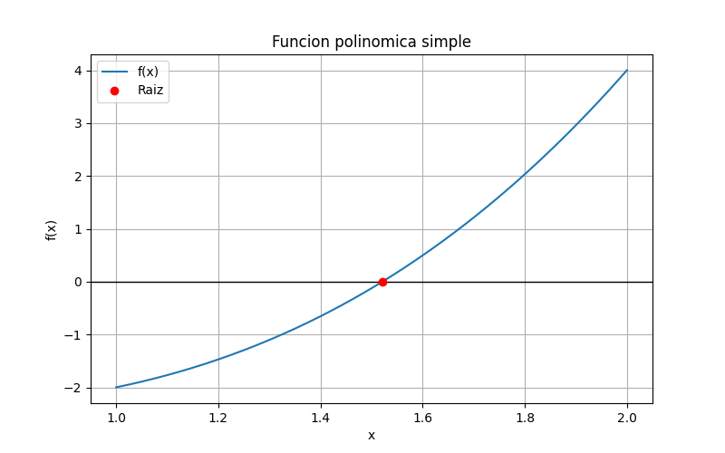

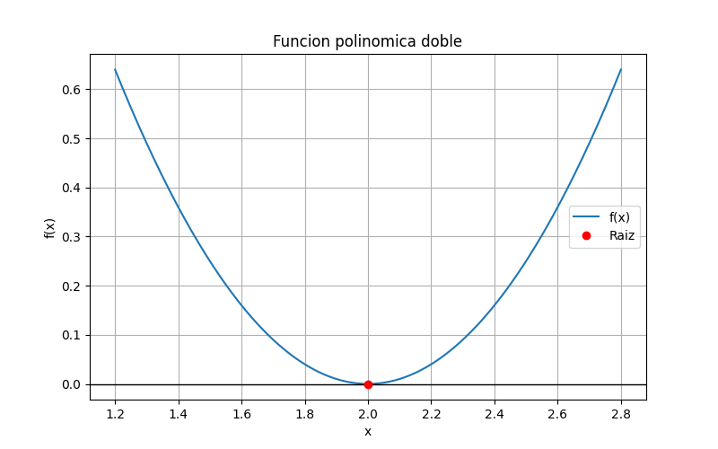

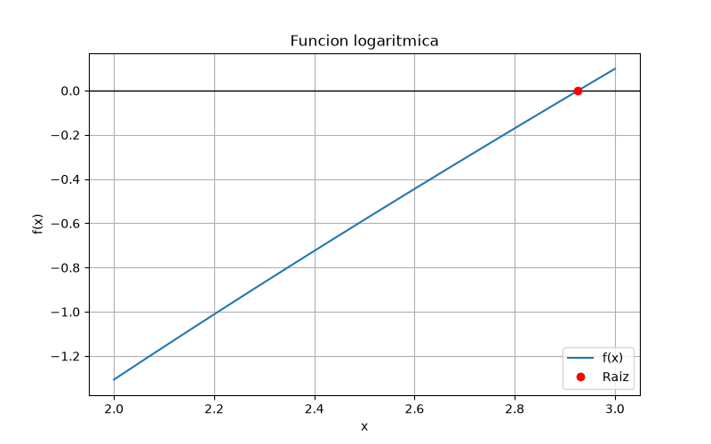

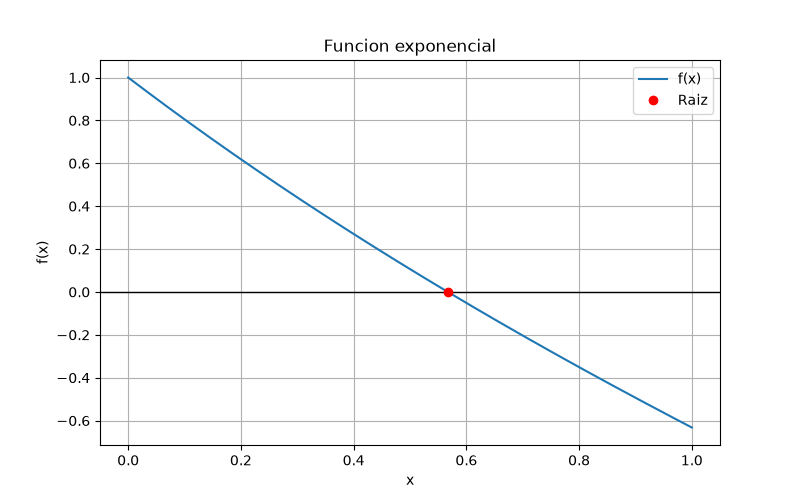

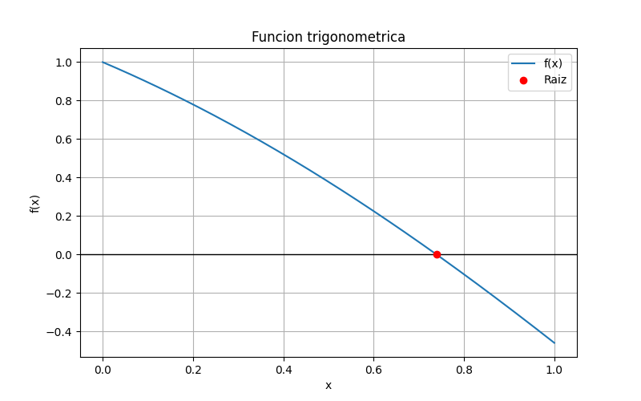

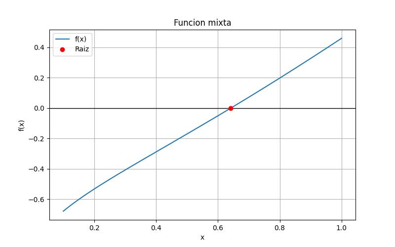

### 5.2. Graficos de convergencia

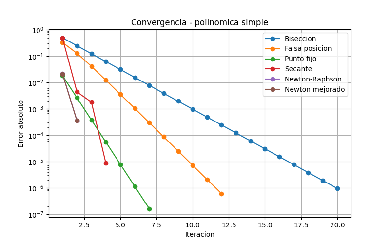

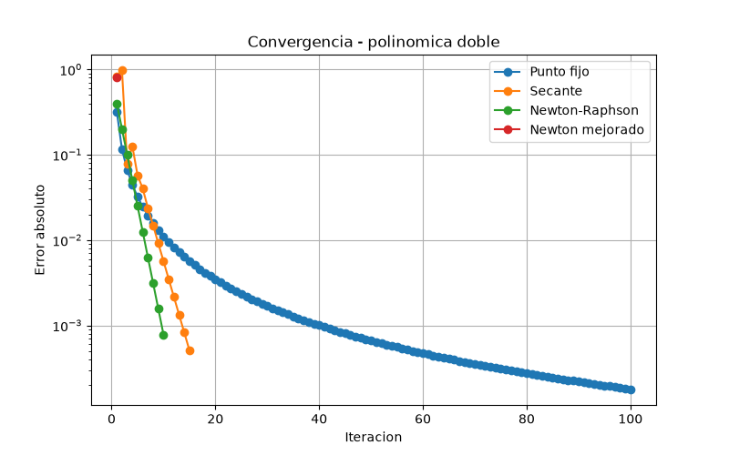

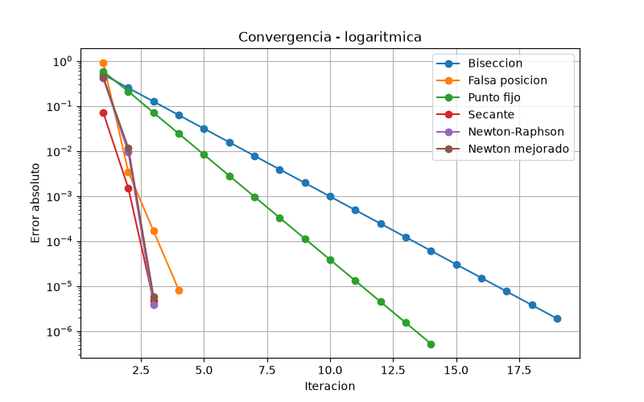

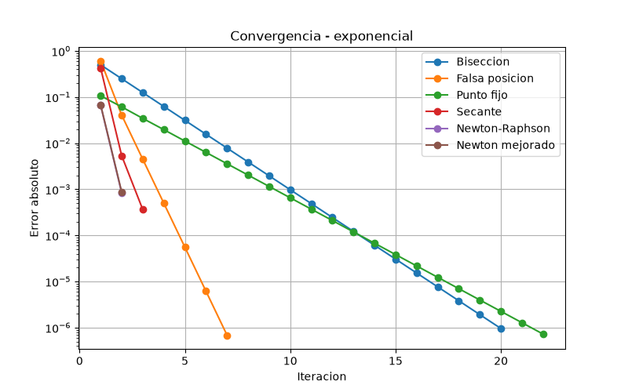

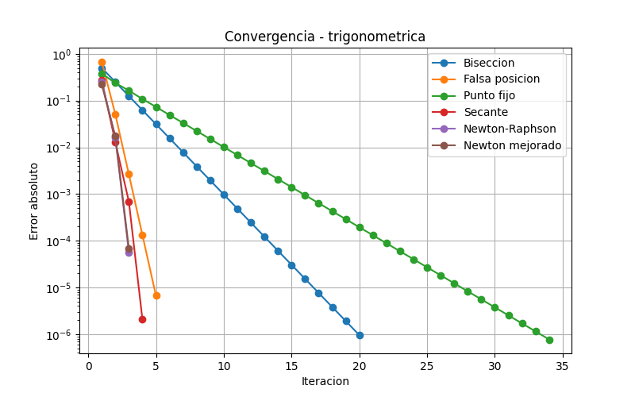

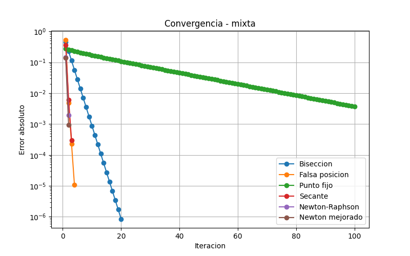

### 5.3. Comparacion de iteraciones

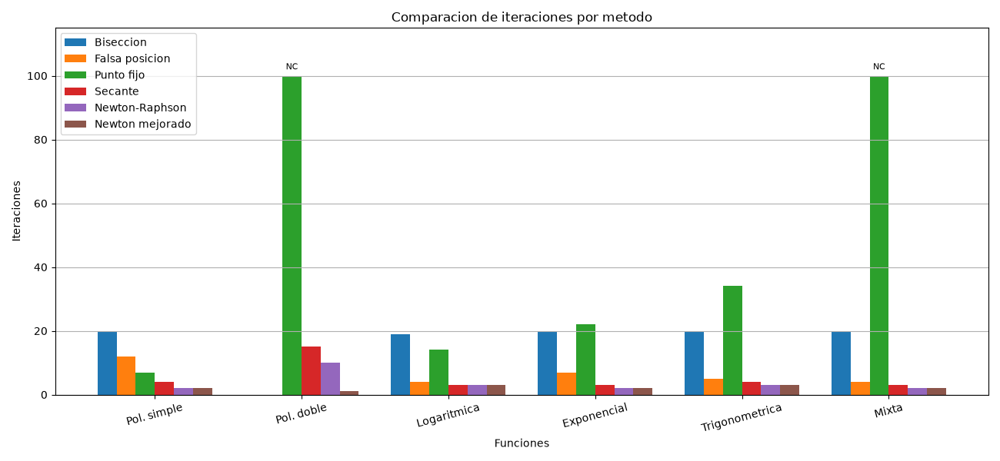

En el grafico comparativo, NC indica que el metodo no alcanzo la tolerancia. Las barras ausentes de los metodos cerrados en la raiz doble corresponden a casos donde no aplica el cambio de signo.

## 6. Conclusion

Los resultados demostraron que no existe un unico metodo que sea el mejor en todas las situaciones.

Biseccion fue un metodo seguro para las funciones que presentaron cambio de signo, aunque generalmente necesito mas iteraciones.

Newton-Raphson y Newton mejorado fueron los mas rapidos en varias funciones, logrando convergencia en 2 o 3 iteraciones.

Secante tambien obtuvo buenos resultados sin necesitar derivadas.

Punto fijo dependio de la funcion utilizada y no alcanzo la tolerancia en los casos polinomico doble y mixto.

En la raiz doble se demostro que tener una raiz no significa necesariamente cambiar de signo. Newton mejorado encontro x = 2 en una iteracion, mientras que los metodos cerrados no pudieron utilizarse con el cambio de signo habitual.

Los experimentos tambien mostraron que modificar el intervalo puede reducir las iteraciones de biseccion y que elegir un buen valor inicial puede mejorar el rendimiento de Newton-Raphson.

En conclusion, recomendamos biseccion cuando la prioridad es la seguridad y existe un cambio de signo, Newton-Raphson cuando se dispone de derivadas y una buena estimacion inicial, secante cuando no se desea calcular derivadas y Newton mejorado para funciones con raices multiples.

La eleccion del metodo debe considerar la velocidad, la precision y las caracteristicas de la funcion.